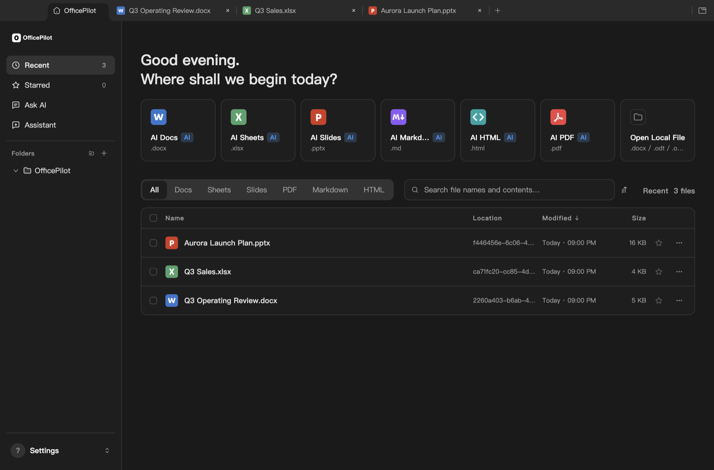
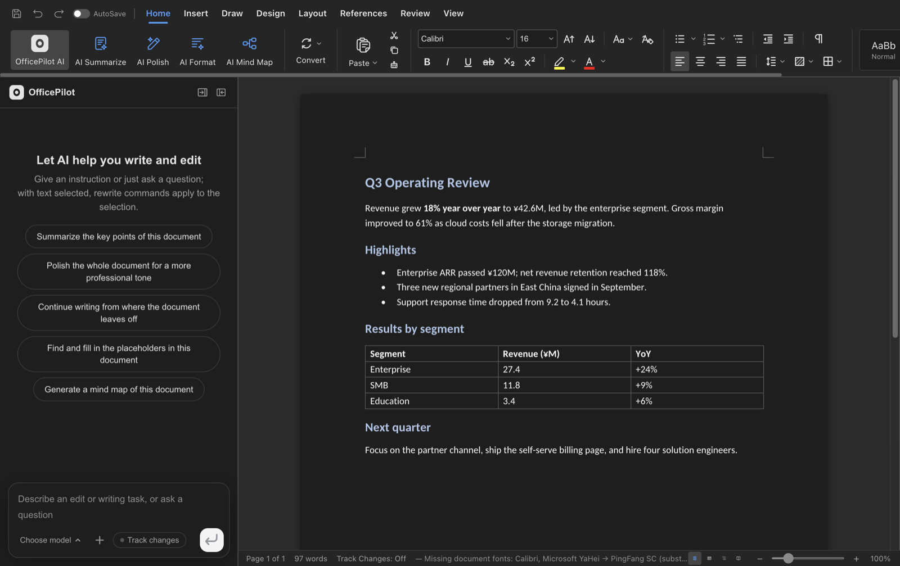
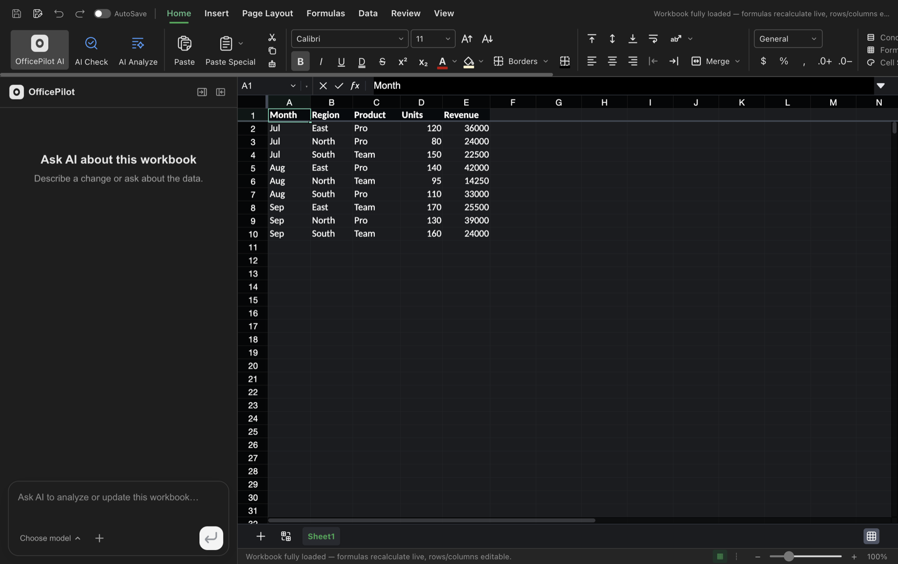
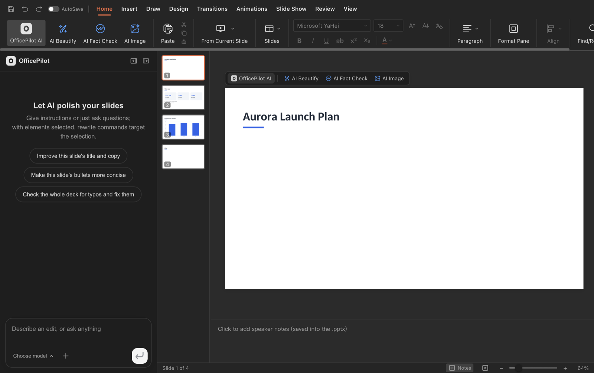

<p align="center">
  
</p>

<h1 align="center">OfficePilot</h1>

<p align="center"><b>An open-source AI office agent with a full office suite built in.</b><br>
Describe the work in plain language: OfficePilot plans it, edits your real Word, Excel and PowerPoint files, and hands the result to an editor you can keep working in.</p>

<p align="center">
  <a href="#license"></a>
  <a href="suite/LICENSE"></a>
  <a href="https://github.com/CrstalLi02/OfficePilot/commits/main"></a>
  <a href="https://github.com/CrstalLi02/OfficePilot/stargazers"></a>
  
  
  
</p>

<p align="center">
  <a href="#get-it"><b>Get it</b></a> ·
  <a href="#a-tour"><b>Tour</b></a> ·
  <a href="#the-assistant"><b>Assistant</b></a> ·
  <a href="#native-office-editing"><b>Office engine</b></a> ·
  <a href="#command-line-and-mcp-server"><b>CLI &amp; MCP</b></a> ·
  <a href="#self-hosting"><b>Self-host</b></a> ·
  <a href="#how-it-works"><b>How it works</b></a>
</p>

OfficePilot is an AI agent for office work that runs on your own machine or
server. Ask for a report, a deck, a spreadsheet or a cleanup of your files; the
agent breaks the job into steps, calls the right tools, and streams every step
as it works. The results are real `.docx`, `.xlsx` and `.pptx` files in your
workspace, not screenshots of documents, and the desktop app opens them in a
full editor suite with its own AI panel.

- **An agent that does the work.** A ReAct loop with parallel tool calls,
  three modes (Craft, Plan, Ask), plans you can review before anything runs,
  background tasks that survive a closed page, and schedules like "every Friday
  at 5 pm, write my weekly report".
- **Real Office files, edited in place.** The built-in engine rewrites only the
  XML it changes and copies everything else byte for byte. Word edits can land
  as tracked changes, Excel formulas stay live, and every change to a file in
  the workspace can be undone in one click.
- **A full editor suite on the desktop.** Docs, Sheets, Slides, PDF, Markdown
  and HTML editors, adapted from [GenOffice](https://github.com/genspark-ai/genoffice).
  Open any workspace file in an editor tab; your saves sync back, and if the
  agent changed the same file meanwhile, both versions are kept.
- **Your workspace, organized by the agent.** Search, read, sort, rename,
  convert and export across My Files, with an undo record for every change and
  no delete tool at all.
- **Your model, your key.** Any OpenAI-compatible service (DeepSeek, Qwen,
  GLM, local servers and more), with separate model lists for text, image and
  video. Keys stay on your machine.
- **Reaches you where you work.** Drive the agent from Feishu (Lark), extend
  it with MCP plugins and `SKILL.md` skills, and give your coding agent the same
  Office engine through the `officepilot` command line or its MCP server.

### Get it

- **Desktop (macOS, Apple Silicon):** build `OfficePilot.app` and a dmg with
  `scripts/build-desktop.sh` (see [Desktop app](#desktop-app)). Signed
  installers for macOS, Windows and Linux are not published yet.
- **Server or Docker:** one Rust binary with the web UI embedded, or
  `docker compose up` (see [Self-hosting](#self-hosting)).
- **Command line:** `cargo install --path cli` gives you `officepilot`, the
  Office engine without the agent (see [Command line and MCP server](#command-line-and-mcp-server)).

## A tour

Every screenshot below is the packaged desktop app on macOS, with sample
documents made by the `officepilot` command line.

### 1 · Home — every file and every editor, one window

<p align="center"></p>

The desktop app opens on the editors' home screen: quick-create cards for each
format, a recent-files list with type filters and full-text search, folders in
the sidebar, and every open document in its own tab. **Assistant** in the
sidebar opens the agent in a tab next to your documents. Closing every window
keeps OfficePilot in the tray, so background tasks, schedules and Feishu
messages keep running.

### 2 · Docs, Sheets and Slides — the real file, an AI panel beside it

<table>
<tr>
<td width="50%"></td>
<td width="50%"></td>
</tr>
<tr>
<td><b>Docs</b> — opens <code>.docx</code> as Word lays it out: headings, lists, tables, headers and footers, comments and tracked changes. The AI panel summarizes, polishes, continues and fills placeholders, with every turn undoable.</td>
<td><b>Sheets</b> — <code>.xlsx</code> with live formulas, charts, pivot tables and conditional formatting on a Rust workbook engine; ask questions about the data and get answers that cite the cells they used.</td>
</tr>
</table>

<p align="center"></p>

**Slides** — edit `.pptx` decks on a canvas with masters, layouts and smart
guides, or have the AI plan a storyline and draft the slides. The PDF,
Markdown and HTML editors share the same panel: edit PDF text in place,
convert PDF to Word, Excel or PowerPoint on the device, and build single-file
HTML pages from a design brief.

### 3 · The assistant — plans, tools and artifacts you can watch

Ask in plain language. The assistant streams its reasoning and each tool call,
and the results land in the artifact panel: documents, decks, sheets, charts,
draw.io diagrams, images and videos, each with a version history you can diff
and restore. In **Plan** mode it proposes the steps first; tick, comment and
confirm, and it carries on from there.

### 4 · My Files — a workspace the agent can organize, and you can undo

Upload files or let the agent save its work here. Type `@` in the chat to point
at a file. The agent can search the full text, read Word, PDF, PowerPoint and
Excel, sort files into folders, rename and convert them, and every change it
makes is recorded with its inverse. **Edit** opens a file in the editor suite;
your saves come back as undoable versions.

## The assistant

| Capability | What you get |
|---|---|
| Streaming and parallel tools | Replies stream token by token. Independent tool calls in the same turn run concurrently, each in its own task with a timeout and panic isolation; results go back to the model in the original order. |
| Craft, Plan and Ask modes | The model picks tools from their descriptions, with no keyword rules. Plan mode submits a plan (`propose_plan`) you can edit and confirm; the run resumes from the same point, even after a page refresh. |
| Artifacts and versions | `artifact_edit` changes only the parts that need changing (a section, a slide, a cell, a chart field) and rolls back the whole batch if any step is invalid. Every generation, AI edit, manual edit and restore is a version you can diff and restore. |
| Background tasks | Runs are decoupled from the browser connection: up to 3 at once per user, the rest queued. Refresh, switch devices or close the page; the task keeps going and notifies you when it finishes. Interrupted runs can be retried in one click. |
| Scheduled tasks | Five-field cron in your time zone, created from chat ("every weekday at 9") or from the task panel with a preview of upcoming runs. Missed runs are made up once; every trigger keeps a record. |
| Data analysis | An in-process SQL engine (Apache DataFusion) profiles and queries CSV, Excel and JSON read-only. Charts and tables are built from the query results, not typed by the model. |
| Skills | Eight built-in `SKILL.md` skills: weekly report, meeting minutes, PRD, competitive analysis, data analysis report, presentation structure, official document and resume polish. Type `/` to use one, import your own, or turn a conversation into a skill. |
| MCP plugins | Connect Streamable HTTP, SSE or local stdio MCP servers, or paste a Claude Desktop / Cursor `mcpServers` block. Write operations can require confirmation; keys are stored encrypted; private-network addresses are blocked by default; tool results are marked as external data. |
| Feishu (Lark) | Message the bot to put the agent to work: long-connection events with no public address needed, live step cards, generated files sent back, plan confirmation from the chat, and scheduled results pushed to the conversation that asked. |
| Editor suite tools | On the desktop the agent can also convert formats (PDF to Word, Excel or PowerPoint, anything to PDF, HTML to Word), fill `{{placeholders}}` in templates, check documents for broken references, stale tables of contents, formula errors and text overflow, render pages for you to see, read what you selected in an editor, and open a file there for you. |

### Agent tools

The agent chooses among these on its own; you never have to name one.

| Area | Tools |
|---|---|
| Create | `doc_generate`, `md_generate`, `sheet_generate`, `ppt_plan`, `ppt_generate`, `chart_generate`, `drawio_generate`, `image_prompt`, `video_generate`, `video_storyboard`, `video_batch_generate` |
| Edit Office files in place | `docs_read`, `docs_apply`, `sheet_read`, `sheet_apply`, `slides_read`, `slides_apply`, `artifact_edit` |
| Workspace | `workspace_list`, `workspace_search`, `workspace_read`, `workspace_write`, `workspace_organize` |
| Data | `data_profile`, `data_query` |
| Editor suite (desktop) | `office_convert`, `office_merge`, `office_check`, `office_render`, `editor_selection`, `editor_open` |
| Research and planning | `web_search`, `propose_plan`, `use_skill`, `read_skill_file` |
| Schedules | `schedule_create`, `schedule_list` |

## AI backends

OfficePilot talks to any **OpenAI-compatible** endpoint. The first-run setup
offers DeepSeek and Qwen (Alibaba Cloud Bailian) presets and a custom slot for
everything else, including local model servers; Settings → Model services keeps
several profiles with their own model lists and switches between them live.
Image and video generation use their own endpoints and model lists. Web search
goes through SearXNG or DuckDuckGo.

On the desktop, **Settings → Integrations → Editor suite → Use OfficePilot's
model** lets the editors' AI panel share the same service. Only the address and
model are written to the editor's settings; the key is handed to the editor
process when OfficePilot starts it and never written to disk there.

## Native Office editing

`engine/` (`officepilot-engine`) reads and edits real Office files in place. It
rewrites only the XML fragments that change and copies every other zip entry
byte for byte; a batch of operations either fully applies or leaves the file
untouched, and errors quote the original text.

| Format | Operations |
|---|---|
| Word `.docx` | Block-level read (paragraphs, headings, lists, tables); find and replace, rewrite, insert Markdown, delete, move, restyle, table cells and comments; optionally as tracked changes |
| Excel `.xlsx` | Values and live formulas (computed, cached, dependents recalculated), formats, column widths, frozen panes, new and renamed sheets, native charts |
| PowerPoint `.pptx` | Text, tables and speaker notes; duplicate, delete and reorder slides; a staged deck builder with 12 layouts, native tables, editable charts, images and notes |

## Command line and MCP server

`officepilot` (about 2.5 MB, no model or network calls) puts the engine in your
terminal and in your coding agent:

```bash
officepilot info report.docx
officepilot read report.docx --from 0 --to 20
officepilot apply report.docx --ops edits.json --track      # tracked changes in Word
officepilot create --type pptx --spec deck.json --out talk.pptx
officepilot convert sales.xlsx --to csv
officepilot slides audit talk.pptx                          # overflow, overlap, tiny fonts
officepilot guide deck                                      # built-in guides for agents
```

Every command supports `--json`. `officepilot mcp` serves the same commands as
19 MCP tools plus `officepilot://guide/*` resources, over stdio or Streamable
HTTP (`--http`, Bearer token required off localhost, per-session sandboxes,
file upload and download, an allowed-roots policy).

**Settings → Integrations** installs the bundled skill into Claude Code, Codex,
Cursor and Gemini CLI with one click, shows ready-to-paste MCP snippets, and on
the desktop links the command line into `~/.local/bin`:

```bash
claude mcp add --transport stdio officepilot -- officepilot mcp
```

## Desktop app

The desktop app is the editor suite's shell with the OfficePilot service inside:

- The service (`walioffice desktop`) runs as a background process, listens on
  `127.0.0.1` only, and signs you in as the local user automatically. It stops
  when you quit from the tray.
- Data lives in `~/Library/Application Support/com.officepilot.desktop`:
  database, uploads, generated files and logs.
- **Edit** on any Word, Excel, PowerPoint, PDF, Markdown or HTML file in My
  Files opens it in an editor tab. Saves sync back as undoable versions; if the
  agent changed the file meanwhile, the editor's copy is saved next to it as
  `<name>（编辑器版本）` instead of overwriting.
- Local-command MCP plugins are allowed, and the login shell's `PATH` is
  picked up so `npx` and `uvx` work.

Build it on macOS (Apple Silicon) with Rust, Node.js 22 and the submodule:

```bash
git submodule update --init suite
scripts/build-desktop.sh
# suite/apps/shell/release/mac-arm64/OfficePilot.app
# suite/apps/shell/release/OfficePilot-<version>-arm64.dmg
```

The build is not signed yet: the first time, right-click the app and choose
**Open**. The earlier Tauri desktop app in `desktop/` still builds on its own
and will be removed once the new app covers everything.

## Self-hosting

The server is a single Rust binary with the web UI embedded.

```bash
cp .env.example .env            # then fill in the settings below
npm install && npm run build    # web UI, then the server (the UI is embedded)
./server/target/release/walioffice
# http://localhost:8000
```

Or with Docker:

```bash
docker compose -f docker-compose-walioffice.yml up -d
# or: docker build -t walioffice . && docker run -p 8000:8000 -v ./data:/app/data walioffice
```

The Dockerfile builds in three stages (web UI on `node:20-slim`, the server on
`rust:1.88-bookworm`, a runtime on `ubuntu:22.04` with ffmpeg). For a full
server deployment with Nginx and HTTPS see [DEPLOY.md](DEPLOY.md).

For development, `npm run dev` starts the web UI with hot reload on
`http://localhost:5173` and the server on `http://localhost:8000`.

### Configuration

| Variable | Required | Default | Description |
|---|---|---|---|
| `AIPPT_JWT_SECRET` | ✅ | — | JWT signing key; change it in production |
| `AIPPT_HOST` / `AIPPT_PORT` | | `0.0.0.0` / `8000` | Listen address and port |
| `LLM_TEXT_BASE_URL` / `LLM_TEXT_API_KEY` / `LLM_TEXT_MODELS` | ✅ | — | Text model service, key and models (comma-separated) |
| `LLM_IMAGE_BASE_URL` / `LLM_IMAGE_API_KEY` / `LLM_IMAGE_MODELS` | ✅ | — | Image model service |
| `LLM_VIDEO_BASE_URL` / `LLM_VIDEO_API_KEY` / `LLM_VIDEO_MODELS` | ✅ | — | Video model service |
| `AIPPT_WEB_SEARCH_PROVIDER` | | `auto` | `auto`, `searxng` or `duckduckgo` |
| `AIPPT_CORS_ORIGINS` | | — | Allowed CORS origins |
| `AIPPT_DATA_DIR` | | `data` | Data directory |
| `DATABASE_URL` | | SQLite in the data directory | `sqlite://…` or `mysql://…` |

Every option, including search endpoints and timeouts, is in
[`.env.example`](.env.example). Sign in with a username and password; the login
page also registers new accounts.

## How it works

```
                 ┌───────────────────────────── Desktop app (Electron) ─────────────────────────────┐
                 │  Home · tabs · Docs · Sheets · Slides · PDF · Markdown · HTML · AI panel         │
                 │  Assistant tab ──────────────────┐            tray · single instance             │
                 └──────────────────────────────────┼───────────────────────────────────────────────┘
   Browser (web) ───────────────────────────────────┤ HTTP / SSE (127.0.0.1 on the desktop)
                                                    ▼
┌─────────────────────────────────── OfficePilot service (Rust, axum + tokio) ───────────────────────────────────┐
│  Auth (JWT) · REST + SSE routes · background tasks · schedules · Feishu · MCP client · editor sync           │
│                                                                                                               │
│  Agent (ReAct, parallel tools) ──► Tool registry ──► create · edit · workspace · data · suite · search · plan │
│        │                                   │                                                                  │
│        ▼                                   ▼                                                                  │
│  OpenAI-compatible LLMs           officepilot-engine (docx / xlsx / pptx in place) · DataFusion · SQLite      │
└───────────────────────────────────────────────────────────────────────────────────────────────────────────────┘
        ▲
        │ the same engine, without the agent
   officepilot CLI · MCP server  ◄── Claude Code · Codex · Cursor · Gemini CLI
```

The original file is always the source of truth. An edit reads the file into
blocks anchored to their original XML, applies a validated batch of operations,
splices only the changed fragments back, and repacks the archive with every
other entry copied as it was. Workspace writes keep a snapshot and an inverse
operation, which is what the one-click undo replays.

### Project layout

```
server/      Rust service: agent, tools, routes, workspace, tasks, schedules, IM, MCP, editor sync
frontend/    React 18 + TypeScript + Vite web UI (embedded into the server binary)
engine/      officepilot-engine: in-place .docx / .xlsx / .pptx reading and editing
cli/         officepilot command line, MCP server and agent skill
suite/       editor suite and desktop shell (git submodule, adapted from GenOffice)
skills/      built-in SKILL.md skills
scripts/     build-suite.sh, build-desktop.sh
desktop/     earlier Tauri desktop app (being retired)
migrations/  SQL migrations (SQLite and MySQL)
```

| Layer | Technology |
|---|---|
| Service | Rust, axum, tokio, sqlx (SQLite, MySQL optional), DataFusion |
| Web UI | React 18, TypeScript, Vite, Tailwind CSS, Zustand |
| Office engine | Pure Rust OOXML reader and writer, byte-preserving |
| Desktop | Electron shell and editors (TypeScript), Rust `.xlsx` sidecar |
| Models | Any OpenAI-compatible API, streamed over SSE |

More detail: [ARCHITECTURE.md](ARCHITECTURE.md) and [DEPLOY.md](DEPLOY.md).

## FAQ

**Does OfficePilot send my files anywhere?**
Files are stored, edited and converted on the machine that runs OfficePilot.
Only the text the agent sends to your model provider leaves it, and only to the
provider you configured.

**Do I need the desktop app?**
No. The web version has the assistant, workspace, tasks, schedules, plugins and
Feishu. The desktop app adds the editor suite and the tools that work with it.

**Can the agent delete my files?**
No. There is no delete tool. Moves, renames, conversions and edits are recorded
with their inverse and can be undone.

**Which models work?**
Any service with an OpenAI-compatible chat API. DeepSeek and Qwen have presets;
everything else, local servers included, goes in the custom slot.

## Acknowledgements

- OfficePilot started from [fuzhengwei/WaLiOffice](https://github.com/fuzhengwei/WaLiOffice)
  (imported at commit `50ad355`) and rebuilt its agent core, workspace, engine
  and desktop app. The DeepSeek Harness plugin for it is at
  [fuzhengwei/walioffice-dsh-plugin](https://github.com/fuzhengwei/walioffice-dsh-plugin).
- The editor suite in `suite/` ([CrstalLi02/officepilot-suite](https://github.com/CrstalLi02/officepilot-suite))
  is a modified version of [GenOffice](https://github.com/genspark-ai/genoffice)
  by Mainfunc, Inc., licensed under Apache-2.0. Most of the editor code comes
  from GenOffice; OfficePilot's changes are listed in
  [`suite/OFFICEPILOT_CHANGES.md`](suite/OFFICEPILOT_CHANGES.md). The fork
  removes the Genspark account and cloud proxy, usage analytics and the
  upstream update feed. GenOffice and Genspark are trademarks of Mainfunc,
  Inc.; this project is not affiliated with Mainfunc, Inc.

## License

OfficePilot is released under the MIT License. The editor suite in `suite/`
keeps its Apache-2.0 license and NOTICE.
